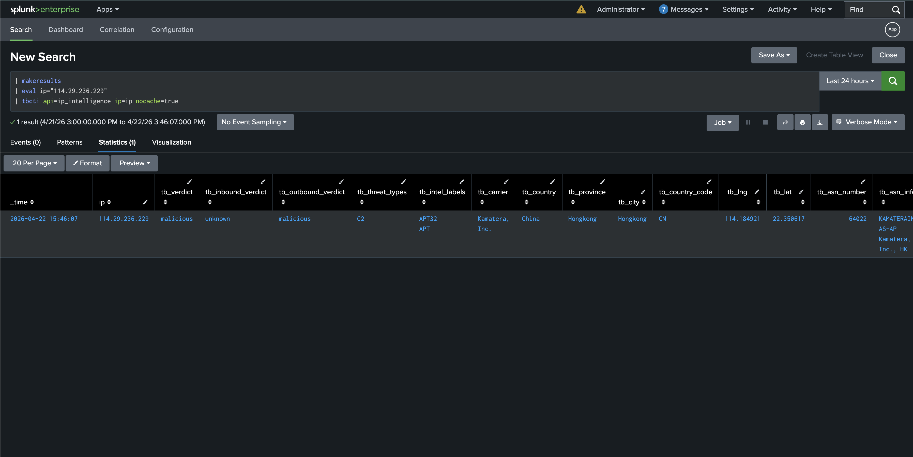
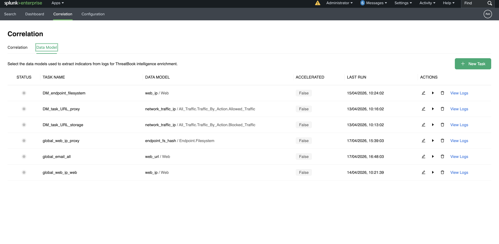
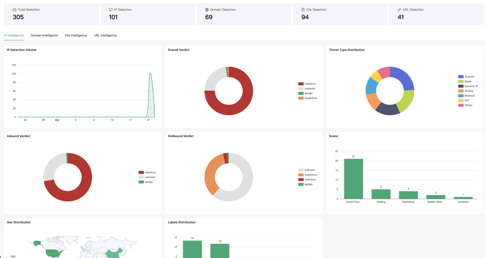
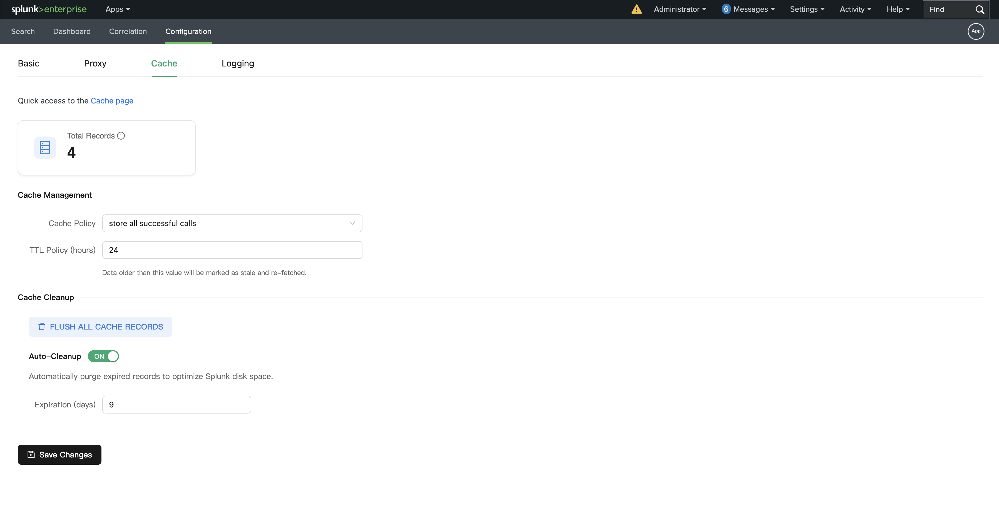

# ThreatBook TI for Splunk

**ThreatBook TI for Splunk** seamlessly integrates with your Splunk environment to provide continuous, high-fidelity threat intelligence enrichment. By connecting to ThreatBook's global intelligence APIs, security operations teams can easily identify, analyze, and pivot on malicious IPs, domains, URLs, and file hashes directly within their Splunk workflows.

## Download & Installation

You can download the app directly from our official Splunkbase page:
👉 **[ThreatBook TI on Splunkbase](https://splunkbase.splunk.com/app/8541)**

## Core Capabilities

### 1. On-Demand SPL Enrichment
Leverage powerful custom SPL commands (`tbcti`) to dynamically query ThreatBook APIs and enrich your security logs in real-time, aiding rapid incident triage.

### 2. Automated Correlation Tasks
Configure periodic, automated index scanning or Splunk CIM Data Model correlation without writing complex code. Proactively hunt for historical and emerging threats in the background.

### 3. Comprehensive Analytics Dashboard
Utilize out-of-the-box analytical dashboards that visualize your organization's threat landscape. Gain deep visibility into IP behaviors, malware families, and malicious domains tied to your infrastructure.

### 4. Efficient Caching & Enterprise Readiness
Built with enterprise environments in mind. Features a highly customizable local KVStore cache to accelerate analytics and reduce redundant API calls, along with full proxy support and compatibility for Search Head and Indexer Clusters.

## Get Started

1. Download the App from [Splunkbase](https://splunkbase.splunk.com/app/8541).
2. Deploy onto your Splunk instance (Standalone, Indexer Cluster, or Search Head Cluster).
3. Navigate to the App configuration settings and input your ThreatBook API key to begin enriching your data.

*For comprehensive instruction guides, please refer to the detailed user manuals available from Threatbook team.*
