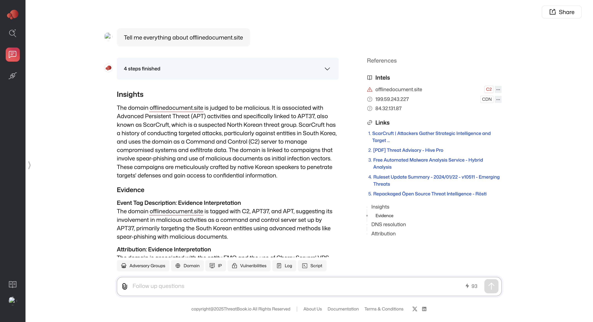
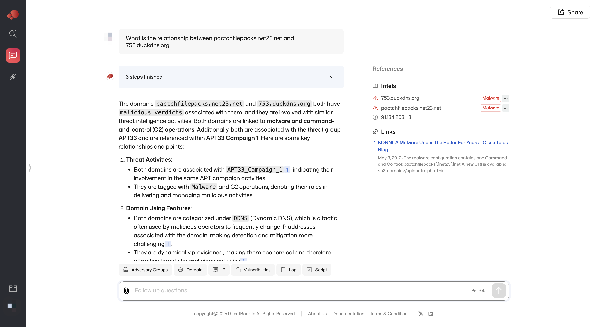
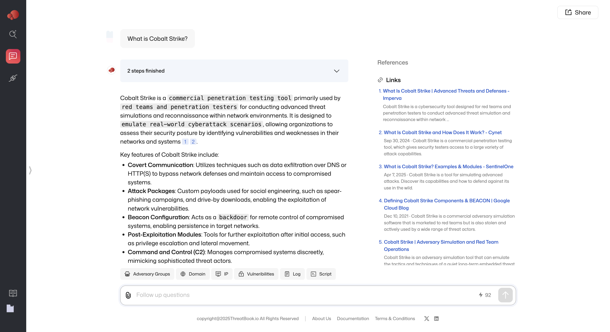
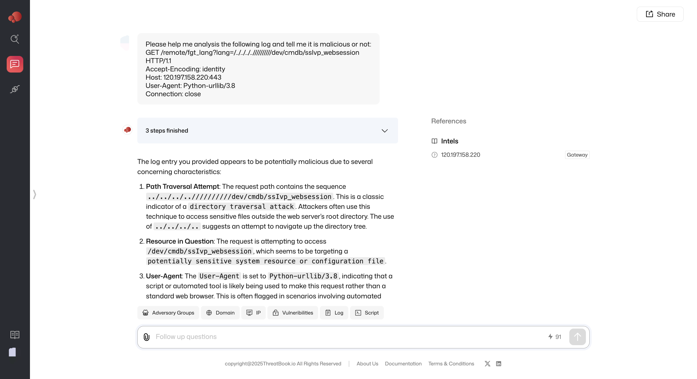

The ThreatBook CTI Chat module allows you to interact with an AI assistant to retrieve threat intelligence, analyze data, and generate reports. Instead of manually searching across multiple sources, you can ask questions or input indicators directly and receive structured intelligence responses.

## Generating In-Depth Threat Intelligence Reports

Users can obtain detailed intelligence reports on IP addresses, domains, vulnerabilities, and hacker groups by selecting a structured query template. These reports provide comprehensive threat assessments, including analysis insight, historical activity, and attribution info.

### How to use it?
1. Open the ThreatBook CTI Chat interface.
2. Choose a template-based query (e.g., IP, Domain, Vulnerability, or Hacker Group).
3. Enter the relevant entity (e.g., an IP address or CVE ID).
4. The AI will generate a comprehensive threat intelligence report, which can be downloaded as a full report.

## Performing General Threat Intelligence Lookups

Users can also enter IP addresses, domains, or vulnerabilities without using templates. The AI will analyze the input and return relevant intelligence.

### How to use it?

1. Type a question of specific address or vulnerability in the chat.
2. The AI will automatically identify the entity type and return the most relevant intelligence.

## Engaging in General Security Q&A

Beyond structured lookups, the Chat module supports general cybersecurity-related inquiries, including:

- Explaining security concepts (e.g., “What is an APT group?”).
- Understanding attack techniques (e.g., “How does an SQL injection work?”).
- Investigating threat actor behaviors (e.g., “Which APT groups target financial institutions?”).

### How to use it?

1. Simply type any cybersecurity-related question.
2. The AI will generate a concise, context-aware response.

💡 Example: Asking “What is Cobalt Strike?” will return an overview of the tool, its legitimate use cases, and how attackers misuse it.

## Analyzing Logs and Scripts

Users can paste logs or scripts into the chat for automated analysis. The AI can:
Identify suspicious activity in logs.

Explain code behavior in scripts.

Highlight potential attack techniques or vulnerabilities.

### How to use it?

1. Choose the Script/Log template and paste a log file snippet or a script into the chat.
2. The AI will analyze its contents, highlight security risks, and provide interpretations.

## Get Started with ThreatBook CTI Chat

Start chatting now at https://i.threatbook.io/chat .

For additional details, please contact us.
